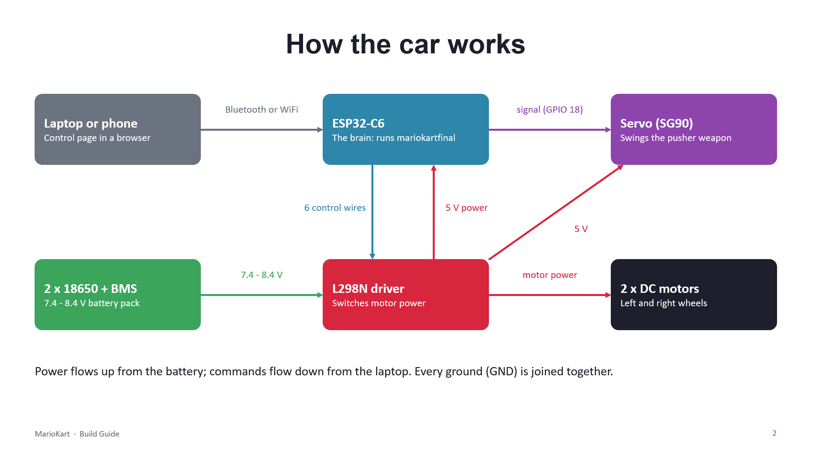

# MarioKart
Firmware and html control page for UCD Elecsoc's MarioKart Makerthon 

## Overview
I designed the circuit and firmware for UCD Elecsoc's makerthon event that contestants will use/build upon. The mechanical design was done by my teammate.

## Hardware
ESP32 C6 DevKit, L298N motor driver, 2 DC motors, 2 18650 Li Ion batteries, BMS, SG90 Micro Servo, 

## How it Works
The ESP32 talks to the car either via bluetooth or WiFi on a web interface using the NimBLEDevice.h and WiFi.h libraries in Arduino IDE. The motor controls are connected to the L298N via the GPIO pins from the ESP32 along with the Servo. The 18650s power the DC motors directly while for the ESP32 and the Servo the voltage is stepped down to 5V. The BMS prevents any other component from being damaged in case a contestant tries to power the ESP32 directly from the batteries.

## Key Challenges
The main challenge was stepping down the voltage to power the Servo without making the circuit design more complicated. I initially wanted to implement a buck converter however that would require the contestants to solder which raised safety concerns within my team and so we scrapped the idea and went with stepping down the voltage through the L298N

## Results
TBA

